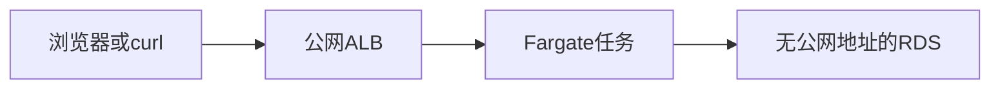

# Phase 2 部署过程

这次部署全部用 AWS CLI 完成，没有在网页上点，也没有用 CDK。控制台能做同样的事，因为网页和命令调用的是同一套 API。本机构建镜像、生成数据库密码这两步只发生在本机，控制台里看不到。

实际网络和「任务在私有子网」的示意图有一处差别：用的是账号里已有的默认 VPC `vpc-0f2bc0f12ba17b825`。Fargate 打开了公网 IP，这样才能自己去 ECR 拉镜像，不用另买 NAT Gateway。RDS 没有公网地址。任务虽然有公网 IP，安全组仍只允许 ALB 访问它的 8080。

- 区域：`ap-southeast-2`（组织策略不允许在东京创建这些资源）
- 账号：`357278306946`
- 登录身份：`aws-demo`
- 访问地址：`http://go-api-1526541297.ap-southeast-2.elb.amazonaws.com`
- 脚本位置：本机 `/tmp/go-api-aws/deploy.sh`。脚本会先查询资源是否已存在，避免重复创建。ECS 服务相关角色那条是脚本失败后单独补跑的。

请求链路：



## 0. 本机登录

控制台右上角先切到亚太地区（悉尼）。命令行则是：

```bash
aws sts get-caller-identity
aws configure get region
```

身份应是 `aws-demo`，区域应是 `ap-southeast-2`。后面每条命令都带 `--region ap-southeast-2`。

## 1. 准备镜像并推到 ECR

本机 Compose 已经构建出 `go-api-api:latest`，架构是 `linux/amd64`，和 Fargate 的 `X86_64` 一致。

| 命令 | 控制台 |
| --- | --- |
| `aws ecr create-repository --repository-name go-api --image-scanning-configuration scanOnPush=true` | ECR → 创建存储库 → 名称 `go-api`，打开推送时扫描 |
| `aws ecr get-login-password \| docker login --username AWS --password-stdin 357278306946.dkr.ecr.ap-southeast-2.amazonaws.com` | 打开仓库后点「查看推送命令」，复制登录那一行 |
| `docker tag go-api-api:latest 357278306946.dkr.ecr.ap-southeast-2.amazonaws.com/go-api:v1` | 无对应按钮，必须在本机打标签 |
| `docker push 357278306946.dkr.ecr.ap-southeast-2.amazonaws.com/go-api:v1` | 同样只在本机执行。推完后，仓库里能看到标签 `v1` |

```bash
aws ecr create-repository --region ap-southeast-2 \
  --repository-name go-api \
  --image-scanning-configuration scanOnPush=true

aws ecr get-login-password --region ap-southeast-2 \
  | docker login --username AWS --password-stdin 357278306946.dkr.ecr.ap-southeast-2.amazonaws.com

docker tag go-api-api:latest 357278306946.dkr.ecr.ap-southeast-2.amazonaws.com/go-api:v1
docker push 357278306946.dkr.ecr.ap-southeast-2.amazonaws.com/go-api:v1
```

## 2. 三个安全组

都建在默认 VPC 里。控制台路径是 **VPC → 安全组 → 创建安全组**。

```bash
aws ec2 create-security-group --region ap-southeast-2 \
  --group-name go-api-alb --description "go-api load balancer" \
  --vpc-id vpc-0f2bc0f12ba17b825

aws ec2 create-security-group --region ap-southeast-2 \
  --group-name go-api-task --description "go-api tasks" \
  --vpc-id vpc-0f2bc0f12ba17b825

aws ec2 create-security-group --region ap-southeast-2 \
  --group-name go-api-db --description "go-api database" \
  --vpc-id vpc-0f2bc0f12ba17b825
```

入站规则用上一步返回的安全组 ID。实际任务安全组 ID 是 `sg-076ac3b9e9d888690`。

```bash
aws ec2 authorize-security-group-ingress --region ap-southeast-2 \
  --group-id <alb安全组> --protocol tcp --port 80 --cidr 0.0.0.0/0

aws ec2 authorize-security-group-ingress --region ap-southeast-2 \
  --group-id <task安全组> --protocol tcp --port 8080 --source-group <alb安全组>

aws ec2 authorize-security-group-ingress --region ap-southeast-2 \
  --group-id <db安全组> --protocol tcp --port 5432 --source-group <task安全组>
```

控制台里是编辑对应安全组的入站规则。

| 安全组 | 谁可以进来 |
| --- | --- |
| `go-api-alb` | 所有人访问 80 |
| `go-api-task` | 只有 ALB 访问 8080 |
| `go-api-db` | 只有 Go 任务访问 5432 |

## 3. 私有 RDS

控制台路径是 **RDS → 数据库 → 创建数据库**。选 PostgreSQL，模板用开发/测试，实例标识符 `go-api-db`，主用户名 `app`。密码是本机随机生成后传给命令的，没有写进仓库。

```bash
aws rds create-db-subnet-group --region ap-southeast-2 \
  --db-subnet-group-name go-api-db \
  --db-subnet-group-description "go-api" \
  --subnet-ids subnet-0e8afc23e21858c8b subnet-0bd81e02d755d0c60 subnet-0efbde43b2a97ff03

aws rds create-db-instance --region ap-southeast-2 \
  --db-instance-identifier go-api-db \
  --db-instance-class db.t4g.micro \
  --engine postgres \
  --engine-version 16.15 \
  --master-username app \
  --master-user-password '<本机生成的密码>' \
  --allocated-storage 20 \
  --storage-type gp3 \
  --db-name app \
  --vpc-security-group-ids <db安全组> \
  --db-subnet-group-name go-api-db \
  --no-publicly-accessible \
  --backup-retention-period 1 \
  --storage-encrypted \
  --no-deletion-protection \
  --no-multi-az

aws rds wait db-instance-available --region ap-southeast-2 \
  --db-instance-identifier go-api-db
```

控制台里「公开访问」选否，VPC 选默认 VPC，安全组选 `go-api-db`。创建大约要几分钟。命令用 `aws rds wait` 等到状态变成 available；网页上则刷新，直到状态是「可用」。

库地址是 `go-api-db.c3a6wwa8qs10.ap-southeast-2.rds.amazonaws.com:5432`，库名 `app`。程序启动时自己建 `users` 表，所以没有单独执行迁移命令。

## 4. 两个 IAM 角色

控制台路径是 **IAM → 角色 → 创建角色**，可信实体选「AWS 服务 → Elastic Container Service → Elastic Container Service Task」。

```bash
aws iam create-role --role-name go-api-execution \
  --assume-role-policy-document '{"Version":"2012-10-17","Statement":[{"Effect":"Allow","Principal":{"Service":"ecs-tasks.amazonaws.com"},"Action":"sts:AssumeRole"}]}'

aws iam attach-role-policy --role-name go-api-execution \
  --policy-arn arn:aws:iam::aws:policy/service-role/AmazonECSTaskExecutionRolePolicy

aws iam create-role --role-name go-api-task \
  --assume-role-policy-document '{"Version":"2012-10-17","Statement":[{"Effect":"Allow","Principal":{"Service":"ecs-tasks.amazonaws.com"},"Action":"sts:AssumeRole"}]}'
```

`go-api-execution` 给 ECS 启动过程用：拉镜像、写日志。`go-api-task` 留给程序运行时用，这次没有给它额外权限。读取数据库连接串的权限是在下一步拿到密钥 ARN 之后，再补到执行角色上的。

## 5. 日志、ALB、目标组

```bash
aws logs create-log-group --region ap-southeast-2 --log-group-name /ecs/go-api

aws elbv2 create-load-balancer --region ap-southeast-2 \
  --name go-api --type application --scheme internet-facing \
  --security-groups <alb安全组> \
  --subnets subnet-0e8afc23e21858c8b subnet-0bd81e02d755d0c60

aws elbv2 create-target-group --region ap-southeast-2 \
  --name go-api --protocol HTTP --port 8080 \
  --vpc-id vpc-0f2bc0f12ba17b825 --target-type ip \
  --health-check-path /health --matcher HttpCode=200

aws elbv2 create-listener --region ap-southeast-2 \
  --load-balancer-arn <ALB的ARN> --protocol HTTP --port 80 \
  --default-actions Type=forward,TargetGroupArn=<目标组ARN>
```

控制台对应位置：

- 日志组：CloudWatch → 日志组 → 创建，名称 `/ecs/go-api`。
- 负载均衡器：EC2 → 负载均衡 → 创建 Application Load Balancer，名称 `go-api`，面向互联网，选上面两个子网和 `go-api-alb`。
- 目标组：同一页或 **目标组**，目标类型选 IP，协议 HTTP，端口 8080，健康检查路径 `/health`。
- 监听器：ALB 的 HTTP:80，默认动作转发到这个目标组。

## 6. 把连接串放进 Secrets Manager

RDS 可用之后，把连接串写成 `postgres://app:<密码>@<RDS地址>:5432/app?sslmode=require`，存成密钥 `go-api/database-url`。云上必须用 `sslmode=require`。本机 Compose 用的是 `sslmode=disable` 和密码 `app`，那套不能拿到云上。

```bash
aws secretsmanager create-secret --region ap-southeast-2 \
  --name go-api/database-url \
  --secret-string '<连接串>'

aws iam put-role-policy --role-name go-api-execution \
  --policy-name read-database-url \
  --policy-document '<允许 secretsmanager:GetSecretValue 这个密钥 ARN>'
```

控制台路径是 **Secrets Manager → 存储新密钥 → 其他类型**，纯文本贴入连接串。然后回到 IAM 角色 `go-api-execution`，内联策略允许读取该密钥。

## 7. 任务定义、集群、服务

任务定义写成 JSON：Fargate、0.25 vCPU、512 MB、镜像 `go-api:v1`、容器端口 8080、环境变量 `PORT` 和 `GIN_MODE`、密钥注入 `DATABASE_URL`、日志进 `/ecs/go-api`。

```bash
aws ecs register-task-definition --region ap-southeast-2 \
  --cli-input-json file://task-def.json

aws ecs create-cluster --region ap-southeast-2 --cluster-name go-api
```

`task-def.json` 的实际内容是：

```json
{
  "family": "go-api",
  "networkMode": "awsvpc",
  "requiresCompatibilities": ["FARGATE"],
  "cpu": "256",
  "memory": "512",
  "runtimePlatform": {"cpuArchitecture": "X86_64", "operatingSystemFamily": "LINUX"},
  "executionRoleArn": "arn:aws:iam::357278306946:role/go-api-execution",
  "taskRoleArn": "arn:aws:iam::357278306946:role/go-api-task",
  "containerDefinitions": [{
    "name": "go-api",
    "image": "357278306946.dkr.ecr.ap-southeast-2.amazonaws.com/go-api:v1",
    "essential": true,
    "portMappings": [{"containerPort": 8080, "protocol": "tcp"}],
    "environment": [
      {"name": "PORT", "value": "8080"},
      {"name": "GIN_MODE", "value": "release"}
    ],
    "secrets": [{"name": "DATABASE_URL", "valueFrom": "arn:aws:secretsmanager:ap-southeast-2:357278306946:secret:go-api/database-url-VUCfwQ"}],
    "logConfiguration": {
      "logDriver": "awslogs",
      "options": {
        "awslogs-group": "/ecs/go-api",
        "awslogs-region": "ap-southeast-2",
        "awslogs-stream-prefix": "go-api"
      }
    }
  }]
}
```

第一次创建服务失败了，因为这个账号还没有 ECS 的服务相关角色。补上之后才创建成功：

```bash
aws iam create-service-linked-role --aws-service-name ecs.amazonaws.com

aws ecs create-service --region ap-southeast-2 \
  --cluster go-api --service-name go-api --task-definition go-api \
  --desired-count 1 --launch-type FARGATE \
  --health-check-grace-period-seconds 90 \
  --network-configuration "awsvpcConfiguration={subnets=[subnet-0e8afc23e21858c8b,subnet-0bd81e02d755d0c60],securityGroups=[sg-076ac3b9e9d888690],assignPublicIp=ENABLED}" \
  --load-balancers "targetGroupArn=<目标组ARN>,containerName=go-api,containerPort=8080"
```

控制台路径是 **ECS → 集群 go-api → 创建服务**：启动类型 Fargate，任务数 1，打开自动分配公有 IP，安全组选 `go-api-task`，负载均衡器选 `go-api`，容器端口 8080。服务相关角色一般在第一次使用 ECS 时由控制台自动创建；命令行遇到缺失时要单独执行上面那条。

## 8. 验收

```bash
curl -s http://go-api-1526541297.ap-southeast-2.elb.amazonaws.com/health
curl -s http://go-api-1526541297.ap-southeast-2.elb.amazonaws.com/users
```

当时健康检查返回正常，并且通过这个地址完成了一次创建和删除用户。

## 控制台入口

区域都要选悉尼 `ap-southeast-2`。

| 资源 | 控制台路径 |
| --- | --- |
| VPC | VPC → 您的 VPC，ID `vpc-0f2bc0f12ba17b825` |
| ALB | EC2 → 负载均衡 → 负载均衡器，名称 `go-api` |
| Fargate 任务 | ECS → 集群 `go-api` → 服务 `go-api` → 任务。EC2 实例列表里看不到它 |
| RDS | RDS → 数据库，实例 `go-api-db` |
