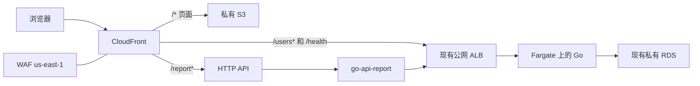

# Phase 3 实现过程

2026-11-09 已按下面的步骤创建资源。做法和 Phase 2 一样：调用同一套 AWS API，不用 CDK，也不用 SAM。控制台能做同样的事。本机当时没有可用的 `aws` 命令，下面的 AWS 命令是实际发出的 API 操作，写成 CLI 是为了能照着看。本机直连悉尼 S3 超时，页面和函数包是经本机代理 `127.0.0.1:7897` 用预签名地址上传的。

已经返回的标识：

- S3 桶 `go-api-frontend-357278306946`，四项公共访问都关闭。对象是 `index.html`（1141 字节）、`assets/index-BSZtelyw.css`（4508）、`assets/index-DkTiscLR.js`（231610）。
- Lambda `go-api-report` 已 Active，不在 VPC 里。执行角色 `go-api-report` 只附加 `AWSLambdaBasicExecutionRole`。
- HTTP API `v9bgdsed66`，地址 `https://v9bgdsed66.execute-api.ap-southeast-2.amazonaws.com/report`。直接调用返回 `{"go_health":"ok","user_count":1}`。
- 源访问控制 `EGOGTJPFPNCK9`。分配 `E357T1GJ1G381I`，域名 `d1zalq3ci35v3c.cloudfront.net`。桶策略只允许这个分配读取。
- Web ACL `go-api-cloudfront`，ID `6a475e95-8c0a-4e28-b856-54b5b3c336d6`，只写在分配的 `WebACLId` 上。`wafv2 associate-web-acl` 不接受这条分配 ARN，实际用的是 `cloudfront associate-distribution-web-acl`。

沿用 Phase 2 的账号和入口，不新建 VPC、RDS 或 Fargate 任务。

- 区域：业务资源在 `ap-southeast-2`。CloudFront 是全球服务，它的命令不带这个区域。WAF 因为要挂到 CloudFront 上，命令必须带 `--region us-east-1`。
- 账号：`357278306946`
- 登录身份：`aws-demo`
- 已有 Go 入口：`http://go-api-1526541297.ap-southeast-2.elb.amazonaws.com`
- 本阶段新建：S3 桶 `go-api-frontend-357278306946`、Lambda `go-api-report`、HTTP API `go-api-report`、CloudFront 分配、Web ACL `go-api-cloudfront`
- 每一步创建前先按名称查询。已经存在就不要再建一个。

请求链路：



`go-api-report` 只读现有 Go 服务，返回健康状态和用户数量。用户的创建、修改、删除仍由页面请求 `/users`，经 CloudFront 转到 ALB，不经过这个函数。

## 0. 本机登录

```bash
aws sts get-caller-identity
aws configure get region
```

身份应是 `aws-demo`，本机默认区域应是 `ap-southeast-2`。后面除 CloudFront 和 WAF 以外，都显式带 `--region ap-southeast-2`。

## 1. 构建前端

对应任务 P3.1。页面已经请求相对路径 `/users` 和 `/health`，生产构建不要改成别的域名，这样和 CloudFront 页面同源，浏览器不会做跨域预检。

```bash
cd frontend
npm install
npm run build
```

2026-11-09 实际只跑了 `npm run build`（`tsc --noEmit && vite build`，Vite 6.4.5），依赖已经装过。产物：

| 文件 | 大小 |
| --- | --- |
| `frontend/dist/index.html` | 1141 字节，换行是 CRLF |
| `frontend/dist/assets/index-BSZtelyw.css` | 4508 |
| `frontend/dist/assets/index-DkTiscLR.js` | 231610 |

构建出的 JS 里有相对路径 `/users` 和 `/health`，没有 `localhost`，也没有 `API_PROXY`。`frontend/.env` 里的 `API_PROXY` 只给本地开发服务器用，不会写进 `dist`。

## 2. 编写 report 函数

对应任务 P3.2。代码放在 `lambda/report`，运行时用 `provided.al2023`。函数不进 VPC，不连 RDS，也没有数据库凭证。它用环境变量 `GO_API_BASE_URL` 访问现有 ALB。

`main.go` 做成这样：

```go
package main

import (
	"context"
	"encoding/json"
	"io"
	"net/http"
	"os"
	"strings"
	"time"

	"github.com/aws/aws-lambda-go/events"
	"github.com/aws/aws-lambda-go/lambda"
)

func handler(ctx context.Context, _ events.APIGatewayV2HTTPRequest) (events.APIGatewayV2HTTPResponse, error) {
	base := strings.TrimRight(os.Getenv("GO_API_BASE_URL"), "/")
	client := &http.Client{Timeout: 3 * time.Second}

	healthStatus, healthCode, err := getJSON(ctx, client, base+"/health")
	if err != nil || healthCode != http.StatusOK {
		return jsonResponse(http.StatusBadGateway, map[string]string{"error": "go api unavailable"}), nil
	}

	usersBody, usersCode, err := getJSON(ctx, client, base+"/users")
	if err != nil || usersCode != http.StatusOK {
		return jsonResponse(http.StatusBadGateway, map[string]string{"error": "go api unavailable"}), nil
	}

	var users []json.RawMessage
	if err := json.Unmarshal(usersBody, &users); err != nil {
		return jsonResponse(http.StatusBadGateway, map[string]string{"error": "go api unavailable"}), nil
	}

	var health struct {
		Status string `json:"status"`
	}
	_ = json.Unmarshal(healthStatus, &health)
	return jsonResponse(http.StatusOK, map[string]any{
		"go_health":  health.Status,
		"user_count": len(users),
	}), nil
}

func getJSON(ctx context.Context, client *http.Client, url string) ([]byte, int, error) {
	req, err := http.NewRequestWithContext(ctx, http.MethodGet, url, nil)
	if err != nil {
		return nil, 0, err
	}
	resp, err := client.Do(req)
	if err != nil {
		return nil, 0, err
	}
	defer resp.Body.Close()
	body, err := io.ReadAll(io.LimitReader(resp.Body, 1<<20))
	return body, resp.StatusCode, err
}

func jsonResponse(status int, payload any) events.APIGatewayV2HTTPResponse {
	body, _ := json.Marshal(payload)
	return events.APIGatewayV2HTTPResponse{
		StatusCode: status,
		Headers:    map[string]string{"content-type": "application/json"},
		Body:       string(body),
	}
}

func main() {
	lambda.Start(handler)
}
```

成功时返回：

```json
{"go_health":"ok","user_count":0}
```

Go 服务连不上时返回 502，正文是 `{"error":"go api unavailable"}`。单测用假的 HTTP 服务器代替 ALB，不要在测试里访问云上地址。

编译成 Amazon Linux 可执行文件。文件名必须是 `bootstrap`，再打成 zip，zip 根目录就是这个文件：

第一次用默认代理下载依赖失败。`proxy.golang.org` 走 IPv6 超时：

```text
dial tcp [2607:f8b0:400a:802::2011]:443: i/o timeout
```

改用国内代理后下载到 `github.com/aws/aws-lambda-go v1.55.1`，单测通过：

```bash
cd lambda/report
GOPROXY=https://goproxy.cn,direct go get github.com/aws/aws-lambda-go@v1.55.1
go test ./...
```

`go test ./...` 的结果是 `ok aws-go/lambda/report 0.719s`。假 HTTP 一次返回 ok 和 2 个用户，一次模拟 Go 服务不可用并期望 502。

接着跑过 `go mod tidy`，它会去拉 `aws-lambda-go` 测试代码依赖的 `github.com/stretchr/testify v1.7.2`，再次撞上 `proxy.golang.org` 超时。tidy 被放弃。`go.mod` 手写为：

```text
module aws-go/lambda/report

go 1.27.3

require github.com/aws/aws-lambda-go v1.55.1
```

编译时加了 `-ldflags='-s -w'`，把体积从大约 7 MB 压到 3.6 MB。文件名必须是 `bootstrap`，zip 根目录就是这个文件：

```bash
cd lambda/report
GOOS=linux GOARCH=amd64 CGO_ENABLED=0 go build -ldflags='-s -w' -o bootstrap .
zip -j function.zip bootstrap
```

实际产物：`bootstrap` 8929440 字节，`function.zip` 3635176 字节。这两个文件已写进 `.gitignore`。Lambda 架构选 `x86_64`，和这个二进制一致。

## 3. 私有 S3 并上传页面

对应任务 P3.3。桶保持私有，先不写桶策略。允许 CloudFront 读取的策略要等分配 ID 出来，放到第 5 步。

```bash
aws s3api head-bucket --bucket go-api-frontend-357278306946 --region ap-southeast-2
```

桶不存在时再创建。悉尼区域必须带 `LocationConstraint`。

```bash
aws s3api create-bucket --region ap-southeast-2 \
  --bucket go-api-frontend-357278306946 \
  --create-bucket-configuration LocationConstraint=ap-southeast-2

aws s3api put-public-access-block --region ap-southeast-2 \
  --bucket go-api-frontend-357278306946 \
  --public-access-block-configuration \
  BlockPublicAcls=true,IgnorePublicAcls=true,BlockPublicPolicy=true,RestrictPublicBuckets=true

```

本机没有可用的 `aws` 命令（`brew install awscli` 没有 bottle），也不能直连悉尼 S3。不带代理的上传在大约 75 秒后失败：

```text
curl: (28) Failed to connect to go-api-frontend-357278306946.s3.ap-southeast-2.amazonaws.com port 443
```

`curl -4 -I https://s3.ap-southeast-2.amazonaws.com` 同样超时。本机有两个代理在监听：`127.0.0.1:7897`（verge-mihomo）和 `127.0.0.1:33331`（clash）。探测结果是 7897 能连上（对桶根目录的 HEAD 返回 405，这是未签名请求的正常结果），33331 的 CONNECT 返回 404。

所以上传没有用 `aws s3 sync`。先为下面四个对象签发 15 分钟的 PUT 预签名地址，签名头包含 `Content-Type`，再经 7897 上传本地原文件。预签名地址含临时凭证，不要写进仓库，过期后也不能复用。

| 对象键 | Content-Type | 本地文件 |
| --- | --- | --- |
| `index.html` | `text/html` | `frontend/dist/index.html` |
| `assets/index-BSZtelyw.css` | `text/css` | `frontend/dist/assets/index-BSZtelyw.css` |
| `assets/index-DkTiscLR.js` | `text/javascript` | `frontend/dist/assets/index-DkTiscLR.js` |
| `_deploy/function.zip` | `application/zip` | `lambda/report/function.zip` |

```bash
curl -4 -x http://127.0.0.1:7897 -X PUT \
  -H "Content-Type: text/html" \
  --upload-file frontend/dist/index.html \
  "$INDEX_URL"
```

CSS、JS 和 zip 用同样的形式，只换 `Content-Type`、本地文件和对应的预签名地址。四次都返回 HTTP 200，整次上传大约 5 秒。列目录核对大小：`index.html` 1141、CSS 4508、JS 231610、zip 3635176，和本地文件一致。四项公共访问仍然全是 true。

这之前曾经用接口直接写入过一版 `index.html`，大小是 1125，换行被改成了 LF。上面这次 PUT 用的是磁盘上的原始字节，把它覆盖成了 1141。`_deploy/function.zip` 只是给下一步创建函数用的临时对象，函数创建成功后就删掉，避免以后被 CloudFront 当成页面文件。

控制台路径是 **S3 → 通用存储桶 → 创建存储桶**。名称用上面的桶名，区域选悉尼，阻止所有公共访问保持打开。上传时把 `dist` 里面的文件传到桶根目录，不要多套一层 `dist/`。机器能直连 S3 时，也可以用：

```bash
aws s3 sync frontend/dist s3://go-api-frontend-357278306946/ --delete --region ap-southeast-2
```

这次没有这么做。

## 4. 发布 Lambda 和 HTTP API

对应任务 P3.4。先查函数和 API 是否已经存在：

```bash
aws lambda get-function --region ap-southeast-2 --function-name go-api-report
aws apigatewayv2 get-apis --region ap-southeast-2 \
  --query "Items[?Name=='go-api-report'].ApiId" --output text
```

### 4.1 执行角色

控制台路径是 **IAM → 角色 → 创建角色**，可信实体选 Lambda。只附加写日志的托管策略。

```bash
aws iam create-role --role-name go-api-report \
  --assume-role-policy-document '{"Version":"2012-10-17","Statement":[{"Effect":"Allow","Principal":{"Service":"lambda.amazonaws.com"},"Action":"sts:AssumeRole"}]}'

aws iam attach-role-policy --role-name go-api-report \
  --policy-arn arn:aws:iam::aws:policy/service-role/AWSLambdaBasicExecutionRole
```

角色刚创建时，Lambda 可能暂时还认不出它。如果创建函数报角色无效，等十几秒再执行一次。

### 4.2 函数

本机调用不了 Lambda API，代码包又已经在同一个区域的桶里，所以创建时用的是 S3 上的 zip，不是 `--zip-file`。创建前 `GetFunction` 返回 `ResourceNotFoundException`，角色已经存在。

```bash
aws lambda create-function --region ap-southeast-2 \
  --function-name go-api-report \
  --runtime provided.al2023 \
  --architectures x86_64 \
  --handler bootstrap \
  --role arn:aws:iam::357278306946:role/go-api-report \
  --timeout 10 \
  --memory-size 128 \
  --code S3Bucket=go-api-frontend-357278306946,S3Key=_deploy/function.zip \
  --environment 'Variables={GO_API_BASE_URL=http://go-api-1526541297.ap-southeast-2.elb.amazonaws.com}'
```

返回时状态是 `Pending`，几秒后变成 `Active`。代码大小 3635176，`VpcConfig` 为空，环境变量就是上面的 ALB 地址。不要设置 `--vpc-config`。留在 VPC 外面，函数才能直接访问公网 ALB，也不用 NAT。

函数能读到代码之后，删掉临时对象，再直接调用一次：

```bash
aws s3api delete-object --region ap-southeast-2 \
  --bucket go-api-frontend-357278306946 \
  --key _deploy/function.zip

aws lambda invoke --region ap-southeast-2 \
  --function-name go-api-report \
  --payload '{}' /tmp/report-out.json
```

调用的 HTTP 状态是 200，没有 `FunctionError`。响应正文是：

```json
{"statusCode":200,"headers":{"content-type":"application/json"},"body":"{\"go_health\":\"ok\",\"user_count\":1}"}
```

当时库里已经有 1 个用户，所以 `user_count` 是 1，不是单测里的 0。删完 zip 后再列目录，桶里只剩三个页面文件。机器上有 `aws` 并且能把本地 zip 传给 Lambda 时，也可以把 `--code` 换成 `--zip-file fileb://lambda/report/function.zip`。

控制台路径是 **Lambda → 创建函数 → 从头开始编写**。运行时选「Amazon Linux 2023 上提供的自定义运行时」，架构 x86_64，执行角色选 `go-api-report`。环境变量 `GO_API_BASE_URL` 填现有 ALB 地址。

日志组会在第一次调用时出现，名称是 `/aws/lambda/go-api-report`。

### 4.3 HTTP API

不用带 `--target` 的快速创建。那种写法会生成一条兜底路由，把所有路径都转进函数。这里只要 `GET /report`。

```bash
aws apigatewayv2 create-api --region ap-southeast-2 \
  --name go-api-report --protocol-type HTTP
```

这次返回的 `ApiId` 是 `v9bgdsed66`，调用地址是 `https://v9bgdsed66.execute-api.ap-southeast-2.amazonaws.com`。创建前 `GetApis` 是空的。

```bash
aws apigatewayv2 create-integration --region ap-southeast-2 \
  --api-id v9bgdsed66 \
  --integration-type AWS_PROXY \
  --integration-uri arn:aws:lambda:ap-southeast-2:357278306946:function:go-api-report \
  --payload-format-version 2.0
```

这次返回的 `IntegrationId` 是 `bda2n4u`。

```bash
aws apigatewayv2 create-route --region ap-southeast-2 \
  --api-id v9bgdsed66 \
  --route-key 'GET /report' \
  --target integrations/bda2n4u

aws apigatewayv2 create-stage --region ap-southeast-2 \
  --api-id v9bgdsed66 --stage-name '$default' --auto-deploy

aws lambda add-permission --region ap-southeast-2 \
  --function-name go-api-report \
  --statement-id apigateway-get-report \
  --action lambda:InvokeFunction \
  --principal apigateway.amazonaws.com \
  --source-arn 'arn:aws:execute-api:ap-southeast-2:357278306946:v9bgdsed66/*/*/report'
```

`$default` 阶段的调用地址没有阶段名：

本机直连这个地址也不稳定，验证时加了同一个代理：

```bash
curl -4 -x http://127.0.0.1:7897 \
  https://v9bgdsed66.execute-api.ap-southeast-2.amazonaws.com/report
curl -4 -x http://127.0.0.1:7897 -o /dev/null -w '%{http_code}\n' \
  https://v9bgdsed66.execute-api.ap-southeast-2.amazonaws.com/users
```

第一条返回 HTTP 200 和 `{"go_health":"ok","user_count":1}`。第二条返回 404，说明没有兜底路由。这一步走的是 API 自己的地址，还没经过 CloudFront，也还没有 WAF。

控制台路径是 **API Gateway → 创建 API → HTTP API**。集成选 Lambda `go-api-report`，路由方法 GET、路径 `/report`，阶段名 `$default` 并打开自动部署。

## 5. 创建 CloudFront

对应任务 P3.5。三条源：

| 源 | 域名 | 回源协议 | 路径 |
| --- | --- | --- | --- |
| 前端 | `go-api-frontend-357278306946.s3.ap-southeast-2.amazonaws.com` | HTTPS，并挂 OAC | 默认 `/*` |
| Go | `go-api-1526541297.ap-southeast-2.elb.amazonaws.com` | 只使用 HTTP 80 | `/health`、`/users*` |
| 报告 | `v9bgdsed66.execute-api.ap-southeast-2.amazonaws.com` | 只使用 HTTPS 443 | `/report*` |

浏览器用 HTTPS。CloudFront 默认证书就够，不申请自己的域名。

`/users*` 会同时匹配 `/users` 和 `/users/1`。行为按这个顺序匹配，越具体的越靠前：`/health`、`/users*`、`/report*`，剩下的才到 S3。

API 和 ALB 都不能接收浏览器原来的 Host。CloudFront 域名传到 API Gateway 会被拒绝。源请求策略用托管策略 `Managed-AllViewerExceptHostHeader`，让 CloudFront 改用源站自己的域名。页面源不需要这个策略。

两个接口行为关闭缓存，使用托管策略 `Managed-CachingDisabled`，并允许 `/users*` 的 GET、POST、PUT、DELETE。页面使用 `Managed-CachingOptimized`。价格等级用 `PriceClass_200`，其中包含澳大利亚，比全球全部边缘站点便宜。

先查出托管策略 ID，不要手写错。2026-11-09 查到的值就是下面 JSON 里用的三个 ID，当时账号里还没有源访问控制，也没有分配：

```bash
aws cloudfront list-cache-policies --type managed \
  --query "CachePolicyList.Items[?CachePolicy.CachePolicyConfig.Name=='Managed-CachingDisabled' || CachePolicy.CachePolicyConfig.Name=='Managed-CachingOptimized'].[CachePolicy.CachePolicyConfig.Name,CachePolicy.Id]" \
  --output text

aws cloudfront list-origin-request-policies --type managed \
  --query "OriginRequestPolicyList.Items[?OriginRequestPolicy.OriginRequestPolicyConfig.Name=='Managed-AllViewerExceptHostHeader'].[OriginRequestPolicy.OriginRequestPolicyConfig.Name,OriginRequestPolicy.Id]" \
  --output text
```

这次查到：

| 策略 | ID |
| --- | --- |
| `Managed-CachingOptimized` | `658327ea-f89d-4fab-a63d-7e88639e58f6` |
| `Managed-CachingDisabled` | `4135ea2d-6df8-44a3-9df3-4b5a84be39ad` |
| `Managed-AllViewerExceptHostHeader` | `b689b0a8-53d0-40ab-baf2-68738e2966ac` |

### 5.1 源访问控制

```bash
aws cloudfront create-origin-access-control --origin-access-control-config \
  Name=go-api-frontend,Description=go-api frontend,SigningProtocol=sigv4,SigningBehavior=always,OriginAccessControlOriginType=s3
```

这次返回的 `Id` 是 `EGOGTJPFPNCK9`。已有同名控制时，用 `aws cloudfront list-origin-access-controls` 取出它，不要重复创建。

### 5.2 分配

把下面的 `EGOGTJPFPNCK9`、`v9bgdsed66` 和三个策略 ID 换成上一步的值，保存为 `distribution.json`。`CallerReference` 每次创建都要换一个新字符串。

```json
{
  "CallerReference": "go-api-frontend-2026-11-09",
  "Comment": "go-api frontend",
  "Enabled": true,
  "PriceClass": "PriceClass_200",
  "HttpVersion": "http2",
  "DefaultRootObject": "index.html",
  "Origins": {
    "Quantity": 3,
    "Items": [
      {
        "Id": "frontend-s3",
        "DomainName": "go-api-frontend-357278306946.s3.ap-southeast-2.amazonaws.com",
        "OriginAccessControlId": "EGOGTJPFPNCK9",
        "S3OriginConfig": {"OriginAccessIdentity": ""}
      },
      {
        "Id": "go-alb",
        "DomainName": "go-api-1526541297.ap-southeast-2.elb.amazonaws.com",
        "CustomOriginConfig": {
          "HTTPPort": 80,
          "HTTPSPort": 443,
          "OriginProtocolPolicy": "http-only",
          "OriginSslProtocols": {"Quantity": 1, "Items": ["TLSv1.2"]}
        }
      },
      {
        "Id": "report-api",
        "DomainName": "v9bgdsed66.execute-api.ap-southeast-2.amazonaws.com",
        "CustomOriginConfig": {
          "HTTPPort": 80,
          "HTTPSPort": 443,
          "OriginProtocolPolicy": "https-only",
          "OriginSslProtocols": {"Quantity": 1, "Items": ["TLSv1.2"]}
        }
      }
    ]
  },
  "DefaultCacheBehavior": {
    "TargetOriginId": "frontend-s3",
    "ViewerProtocolPolicy": "redirect-to-https",
        "AllowedMethods": {
          "Quantity": 2,
          "Items": ["GET", "HEAD"],
          "CachedMethods": {"Quantity": 2, "Items": ["GET", "HEAD"]}
        },
        "CachePolicyId": "658327ea-f89d-4fab-a63d-7e88639e58f6",
    "Compress": true
  },
  "CacheBehaviors": {
    "Quantity": 3,
    "Items": [
      {
        "PathPattern": "/health",
        "TargetOriginId": "go-alb",
        "ViewerProtocolPolicy": "redirect-to-https",
        "AllowedMethods": {
          "Quantity": 2,
          "Items": ["GET", "HEAD"],
          "CachedMethods": {"Quantity": 2, "Items": ["GET", "HEAD"]}
        },
        "CachePolicyId": "4135ea2d-6df8-44a3-9df3-4b5a84be39ad",
        "OriginRequestPolicyId": "b689b0a8-53d0-40ab-baf2-68738e2966ac",
        "Compress": true
      },
      {
        "PathPattern": "/users*",
        "TargetOriginId": "go-alb",
        "ViewerProtocolPolicy": "redirect-to-https",
        "AllowedMethods": {
          "Quantity": 7,
          "Items": ["GET", "HEAD", "OPTIONS", "PUT", "POST", "PATCH", "DELETE"],
          "CachedMethods": {"Quantity": 2, "Items": ["GET", "HEAD"]}
        },
        "CachePolicyId": "4135ea2d-6df8-44a3-9df3-4b5a84be39ad",
        "OriginRequestPolicyId": "b689b0a8-53d0-40ab-baf2-68738e2966ac",
        "Compress": true
      },
      {
        "PathPattern": "/report*",
        "TargetOriginId": "report-api",
        "ViewerProtocolPolicy": "redirect-to-https",
        "AllowedMethods": {
          "Quantity": 2,
          "Items": ["GET", "HEAD"],
          "CachedMethods": {"Quantity": 2, "Items": ["GET", "HEAD"]}
        },
        "CachePolicyId": "4135ea2d-6df8-44a3-9df3-4b5a84be39ad",
        "OriginRequestPolicyId": "b689b0a8-53d0-40ab-baf2-68738e2966ac",
        "Compress": true
      }
    ]
  }
}
```

```bash
aws cloudfront create-distribution --distribution-config file://distribution.json
aws cloudfront wait distribution-deployed --id E357T1GJ1G381I
```

这次创建立刻返回：分配 `E357T1GJ1G381I`，域名 `d1zalq3ci35v3c.cloudfront.net`，状态 `InProgress`。等了大约 3 分钟后再查，状态是 `Deployed`。三条行为和三个源与上表一致：默认源 `frontend-s3` 挂着 OAC `EGOGTJPFPNCK9`，ALB 是 `http-only`，API 是 `https-only`。

部署通常要几分钟到十几分钟。控制台路径是 **CloudFront → 分配 → 创建分配**。源、行为和查看器协议按上表填写。默认根对象填 `index.html`。

页面只有一个地址 `/`，没有前端路由。不需要把 403 或 404 再写回 `index.html`。

### 5.3 补上桶策略

分配创建之后才能写这条策略。四项「阻止公共访问」保持打开；这条策略只允许这一支分配读取，不算公开访问。

```bash
aws s3api put-bucket-policy --region ap-southeast-2 \
  --bucket go-api-frontend-357278306946 \
  --policy '{
    "Version": "2012-10-17",
    "Statement": [{
      "Sid": "AllowCloudFrontRead",
      "Effect": "Allow",
      "Principal": {"Service": "cloudfront.amazonaws.com"},
      "Action": "s3:GetObject",
      "Resource": "arn:aws:s3:::go-api-frontend-357278306946/*",
      "Condition": {
        "StringEquals": {
          "AWS:SourceArn": "arn:aws:cloudfront::357278306946:distribution/E357T1GJ1G381I"
        }
      }
    }]
  }'
```

这条策略是在分配还处于 `InProgress` 时写入的。写完后再读回来，条件和分配 ARN 一致，四项公共访问仍是 true。控制台在存储桶的 **权限 → 存储桶策略**。

部署完成后，经代理 `127.0.0.1:7897` 看页面和两个接口。当时 WAF 还没挂上：

```bash
curl -4 -sS -D - -o /tmp/cf-index.html -x http://127.0.0.1:7897 \
  https://d1zalq3ci35v3c.cloudfront.net/
curl -4 -sS -D - -x http://127.0.0.1:7897 \
  https://d1zalq3ci35v3c.cloudfront.net/health
curl -4 -sS -D - -x http://127.0.0.1:7897 \
  https://d1zalq3ci35v3c.cloudfront.net/report
curl -4 -sS -x http://127.0.0.1:7897 \
  http://go-api-1526541297.ap-southeast-2.elb.amazonaws.com/health
```

实际结果：

| 请求 | 状态 | 正文 | 说明 |
| --- | --- | --- | --- |
| `/` | 200 | 1141 字节的 `index.html` | `server: AmazonS3`，第一次 `x-cache: Miss from cloudfront`，边缘是 `NRT20-P1` |
| `/health` | 200 | `{"status":"ok"}` | 没有 `apigw-requestid`，来自 ALB 后面的 Go |
| `/report` | 200 | `{"go_health":"ok","user_count":1}` | 响应头有 `apigw-requestid`，来自 API Gateway |
| ALB `/health` | 200 | `{"status":"ok"}` | 直连，不经过 CloudFront |

再各请求一次，用来确认缓存策略：页面第二次是 `x-cache: Hit from cloudfront`，`/health` 第二次仍是 `Miss from cloudfront`。

以后重新上传前端时，执行一次失效，否则边缘节点还会拿着旧的 `index.html`：

```bash
aws cloudfront create-invalidation --distribution-id E357T1GJ1G381I --paths '/*'
```

## 6. 给 CloudFront 挂 WAF

对应任务 P3.6。Web ACL 的范围是 `CLOUDFRONT`，区域只能是 `us-east-1`。不要在悉尼创建，也不要关联到 Lambda、ALB 或 API Gateway。

三条规则：

| 优先级 | 名称 | 作用 |
| --- | --- | --- |
| 0 | `AWSManagedRulesCommonRuleSet` | 通用规则，包含常见 XSS 检查 |
| 1 | `AWSManagedRulesSQLiRuleSet` | SQL 注入检查 |
| 2 | `RateLimitPerIP` | 同一 IP 五分钟超过 2000 次就拦截 |

2000 这个数是为了学习时自己点页面不会被误伤。托管规则用 `OverrideAction: None`，限速规则才用 `Action: Block`。

先查询同名 ACL：

```bash
aws wafv2 list-web-acls --scope CLOUDFRONT --region us-east-1 \
  --query "WebACLs[?Name=='go-api-cloudfront']"
```

没有时创建。规则保存为 `waf-rules.json`：

```json
[
  {
    "Name": "AWSManagedRulesCommonRuleSet",
    "Priority": 0,
    "Statement": {
      "ManagedRuleGroupStatement": {
        "VendorName": "AWS",
        "Name": "AWSManagedRulesCommonRuleSet"
      }
    },
    "OverrideAction": {"None": {}},
    "VisibilityConfig": {
      "SampledRequestsEnabled": true,
      "CloudWatchMetricsEnabled": true,
      "MetricName": "CommonRuleSet"
    }
  },
  {
    "Name": "AWSManagedRulesSQLiRuleSet",
    "Priority": 1,
    "Statement": {
      "ManagedRuleGroupStatement": {
        "VendorName": "AWS",
        "Name": "AWSManagedRulesSQLiRuleSet"
      }
    },
    "OverrideAction": {"None": {}},
    "VisibilityConfig": {
      "SampledRequestsEnabled": true,
      "CloudWatchMetricsEnabled": true,
      "MetricName": "SQLiRuleSet"
    }
  },
  {
    "Name": "RateLimitPerIP",
    "Priority": 2,
    "Statement": {
      "RateBasedStatement": {"Limit": 2000, "AggregateKeyType": "IP"}
    },
    "Action": {"Block": {}},
    "VisibilityConfig": {
      "SampledRequestsEnabled": true,
      "CloudWatchMetricsEnabled": true,
      "MetricName": "RateLimitPerIP"
    }
  }
]
```

```bash
aws wafv2 create-web-acl --region us-east-1 \
  --name go-api-cloudfront --scope CLOUDFRONT \
  --default-action Allow={} \
  --visibility-config SampledRequestsEnabled=true,CloudWatchMetricsEnabled=true,MetricName=go-api-cloudfront \
  --rules file://waf-rules.json
```

返回的 Web ACL 是 `arn:aws:wafv2:us-east-1:357278306946:global/webacl/go-api-cloudfront/6a475e95-8c0a-4e28-b856-54b5b3c336d6`。

`wafv2 associate-web-acl` 不接受 CloudFront 分配的 ARN，会报 `WAFInvalidParameterException`。关联改走 CloudFront 自己的接口。先取分配的 `ETag`，再关联：

```bash
aws cloudfront get-distribution --id E357T1GJ1G381I --query ETag --output text

aws cloudfront associate-distribution-web-acl \
  --id E357T1GJ1G381I \
  --web-acl-arn arn:aws:wafv2:us-east-1:357278306946:global/webacl/go-api-cloudfront/6a475e95-8c0a-4e28-b856-54b5b3c336d6 \
  --if-match E23ZP02F085DFQ
```

这次关联前的 `ETag` 是 `E23ZP02F085DFQ`。`wafv2 associate-web-acl` 用分配 ARN `arn:aws:cloudfront::357278306946:distribution/E357T1GJ1G381I` 时失败，错误是：

```text
WAFInvalidParameterException: The ARN isn't valid. ... field: RESOURCE_ARN
```

`get-web-acl-for-resource` 用同一条 ARN 也是这个错误。`list-resources-for-web-acl --resource-type CLOUDFRONT` 则直接不接受这个枚举，当前允许的类型里没有 CloudFront。所以关联和验收都改走 CloudFront 自己的字段。

关联命令返回的新 `ETag` 是 `ETVPDKIKX0DER`。再读分配，状态仍是 `Deployed`，`DistributionConfig.WebACLId` 就是上面这条 Web ACL ARN。三条规则的优先级、`OverrideAction` 和限速 `Block` 与 `waf-rules.json` 一致，默认动作是 Allow。Lambda `GetFunctionConfiguration` 的 `VpcConfig` 为空，状态 Active，配置里没有 Web ACL 字段。

用代理打一条会被通用规则拦住的查询，再打一次正常页面：

```bash
curl -4 -sS -D - -o /tmp/waf-body.txt -x http://127.0.0.1:7897 \
  'https://d1zalq3ci35v3c.cloudfront.net/?x=%3Cscript%3Ealert(1)%3C/script%3E'
curl -4 -sS -o /dev/null -w '%{http_code}\n' -x http://127.0.0.1:7897 \
  https://d1zalq3ci35v3c.cloudfront.net/
```

第一条是 HTTP 403，`server: CloudFront`，`x-cache: Error from cloudfront`。第二条仍是 200。不带代理时，普通页面有一次直接返回 200，紧接着的请求又超时，所以后面的验收都走 7897。

控制台要先把右上角区域换成弗吉尼亚北部，再进 **WAF & Shield → Web ACL → 创建 Web ACL**。资源类型选 CloudFront 分配。关联完成后再切回悉尼看 Lambda：函数配置里不会出现 Web ACL。

直接访问下面两个地址不会经过这层 WAF，Phase 3 故意留着，用来和 CloudFront 对照：

- `http://go-api-1526541297.ap-southeast-2.elb.amazonaws.com`
- `https://v9bgdsed66.execute-api.ap-southeast-2.amazonaws.com/report`

姓名里如果故意写 `<script>` 这类内容，通用规则可能拦截页面提交。普通姓名和邮箱应能通过。

这一步是主要新增费用：一个 Web ACL 加三条规则大约每月 8 美元，另加请求费。

## 7. 验收

对应任务 P3.7。分配域名是 `d1zalq3ci35v3c.cloudfront.net`。

```bash
curl -s https://d1zalq3ci35v3c.cloudfront.net/health
curl -s https://d1zalq3ci35v3c.cloudfront.net/report
curl -s http://go-api-1526541297.ap-southeast-2.elb.amazonaws.com/health
```

前两条分别来自 Go 和 Lambda。第三条确认原来的 ALB 还能直接访问。

2026-11-09 已在浏览器打开 `https://d1zalq3ci35v3c.cloudfront.net/` 做完这一轮。页面标题是「名册 · 用户登记」，侧栏先显示「用户服务可用」，当时在册 1 人：`Yanbin Li`，邮箱 `964604639@qq.com`。

操作顺序：

1. 点「登记用户」。姓名填 `Phase3 Check`，邮箱填 `phase3-check-20261109@example.com`，点「保存」。提示「已登记」，人数变成 2，新记录编号是 4。
2. 点这条记录的「修改」，姓名改成 `Phase3 Updated`，再保存。提示「已更新」，列表里的姓名跟着变了。
3. 点这条记录的「删除」，确认框写的是 `Phase3 Updated （ phase3-check-20261109@example.com ）会从名册中移除`。点「确认删除」。提示「已删除 Phase3 Updated」，人数回到 1，只剩 `Yanbin Li`。

做完后再查：

```bash
curl -4 -sS -x http://127.0.0.1:7897 https://d1zalq3ci35v3c.cloudfront.net/health
curl -4 -sS -x http://127.0.0.1:7897 https://d1zalq3ci35v3c.cloudfront.net/report
curl -4 -sS -x http://127.0.0.1:7897 \
  http://go-api-1526541297.ap-southeast-2.elb.amazonaws.com/health
```

三条结果依次是 `{"status":"ok"}`、`{"go_health":"ok","user_count":1}`、`{"status":"ok"}`。用户数量回到删除前的数字。以后重做时也按登记、在列表里看到、修改姓名、删除的顺序，做完后再查 `/report`。

确认 WAF 挂在分配上，而不是挂在 Lambda 上：

```bash
aws cloudfront get-distribution --id E357T1GJ1G381I \
  --query "Distribution.DistributionConfig.WebACLId" --output text
```

这条应返回 `arn:aws:wafv2:us-east-1:357278306946:global/webacl/go-api-cloudfront/6a475e95-8c0a-4e28-b856-54b5b3c336d6`。`wafv2 get-web-acl-for-resource` 和 `list-resources-for-web-acl --resource-type CLOUDFRONT` 现在都不接受 CloudFront 分配，不能用来做这次验收。Lambda 函数配置里没有 Web ACL。

## 控制台入口

| 资源 | 区域 | 控制台路径 |
| --- | --- | --- |
| 前端桶 | 悉尼 | S3 → 通用存储桶 `go-api-frontend-357278306946` |
| report 函数 | 悉尼 | Lambda → 函数 `go-api-report` |
| HTTP API | 悉尼 | API Gateway → API `go-api-report` |
| 分配 | 全球，控制台不按悉尼过滤 | CloudFront → 分配，注释 `go-api frontend` |
| Web ACL | 弗吉尼亚北部 | WAF & Shield → Web ACL `go-api-cloudfront` |
| 原来的 Go 服务 | 悉尼 | EC2 → 负载均衡器 `go-api`，ECS 集群 `go-api` |
